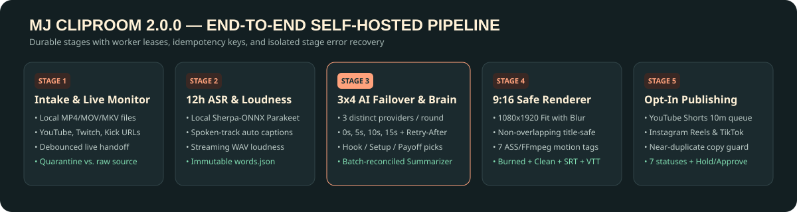
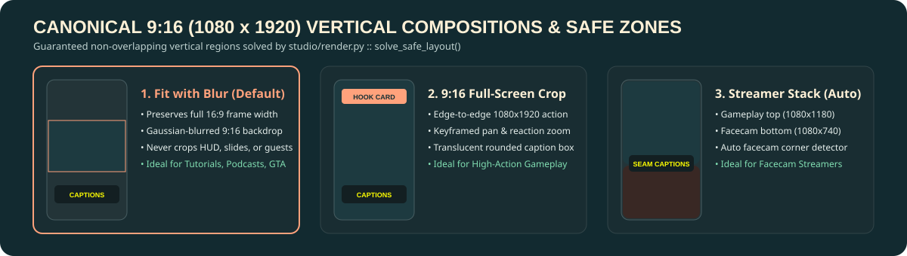

# MJ Cliproom · 2.0.0


**MJ Cliproom 2.0.0** is a self-hosted, all-in-one workstation for clipping, editing, summarizing, and publishing vertical `9:16` (`1080×1920`) video. It works across gaming and tournament streams, podcasts, interviews, tutorials, creator highlights, and other authorized footage while keeping all gaming presets and the **MJ Plays GTA** workflow ready out of the box.

[Install or update](docs/INSTALL.md) · [YouTube setup and posting](docs/YOUTUBE_AUTOMATION.md) · [Tournament workflow](docs/TOURNAMENT_WORKFLOW.md) · [Changelog](CHANGELOG.md) · [Credits](CREDITS.md)

---

## Architecture & End-to-End Pipeline



---

## What's New in 2.0.0

### 1. Six-Section All-in-One Workstation
- **Home (`overview`)** — Unified **New project** composer for local video files (`MP4`, `MOV`, `MKV`, `WebM`), replay URLs, and live stream URLs across YouTube, Twitch, and Kick, plus 14-day analytics and **Content Presets** (`MJ Plays GTA`, `Gaming & Esports`, `Podcast & Talk`, `Interview & Q&A`, `Tutorial & How-To`, `Creator Highlights`).
- **All Videos and Live (`library`)** — Unified project and live recording library with real-time download bytes/speed/ETA, render queue positions, quarantined partial-download indicators, and reviewable raw source cleanup.
- **Editor (`editor_view`)** — Frame-accurate source timeline editor, multi-cut segment splicer, moving crop keyframes, timed caption and glossary editor, and `1080×1920` title-safe layout solver.
- **Summaries (`summaries`)** — Versioned, timestamped **Summarize** workstation for an entire source video, custom time range, or rendered clip set, with 20-minute batch reconciliation on recordings up to 12 hours, clickable jump-to-play timecodes, coverage/uncertainty badges, and **Markdown (`.md`)**, **Plain Text (`.txt`)**, and **JSON (`.json`)** exports.
- **Publishing (`autopilot_posts` & `autopilot`)** — 9-stage durable publishing pipeline with idempotency keys, pre-enqueue `9:16` and near-duplicate metadata verification, 7 distinct statuses (`Scheduled`, `Uploading`, `Processing`, `Public`, `Private`, `Held`, `Failed`), 10-minute spacing, Hold/Approve controls, and opt-in YouTube Autopilot.
- **Settings (`settings`)** — Multi-profile AI router with ordered failover priority, per-provider transcript privacy controls, local provider toggles, connected OAuth accounts (YouTube, Instagram Reels, TikTok), Light/Dark/System themes, and storage management.

### 2. Canonical 9:16 Vertical Composition & Safe Zones



- **Fit with blur (`blur`, default)** — Scales the full source frame cleanly inside a `1080×1920` vertical canvas over a Gaussian-blurred, darkened `9:16` backdrop so HUD elements, slides, and two-shot guests are never cropped off.
- **9:16 Full-screen crop (`crop`)** — Edge-to-edge `1080×1920` center or keyframed action crop.
- **Streamer facecam stack (`auto` / `stack`)** — Places gameplay on top (`1080×1180`) and the detected streamer facecam below (`1080×740`).
- **7 Original FFmpeg/ASS Motion Presets** — `None`, `MJ title tag`, `Kinetic hook card`, `Lower-third banner`, `Beat punch-in zoom`, `Swipe reveal bar`, and `Blurred parallax float`.
- **Non-Overlapping Title-Safe Solver & Subtitle Exports** — `render.solve_safe_layout()` guarantees zero collision between brand badges, hooks, lower-thirds, and translucent rounded caption boxes (`Style: Box`). Every clip exports burned-in MP4, clean MP4, `.srt`, and `.vtt` subtitles.

### 3. Sensitive AI Provider Failover (3×4 Bounded Retries)
- Save and order multiple AI profiles across **Google Gemini, Z.AI GLM, OpenAI, Anthropic Claude, xAI Grok, Groq, OpenRouter (including OpenRouter Free), DeepSeek, Alibaba Qwen, and local LM Studio / Ollama**.
- **Bounded 3×4 State Machine:** Tries up to **3 eligible, distinct providers per round** across at most **4 rounds** (`0s` initial round, then `5s`, `10s`, and `15s` inter-round waits — ceiling of 12 requests per operation).
- **Strict `Retry-After` & Privacy Obedience:** Honors provider `Retry-After` headers, marks `401/403` credentials as `Requires configuration` immediately, retries malformed JSON within the same operation budget, and enforces per-provider `allow_clip_text` privacy settings.

---

## Install & Run (Windows, macOS, Linux)

MJ Cliproom requires **Git**, **Python 3.10+**, and **FFmpeg** (with `ffprobe`). On Windows, run the one-click installer or batch launcher from the project checkout:

```powershell
git clone https://github.com/SheikhMamoonIjaz/MJ-Cliproom.git
Set-Location MJ-Cliproom
.\install-mj-cliproom.bat
.\Start-MJ-Cliproom.bat
```

Or run the supervised launcher directly:

```powershell
.\.venv\Scripts\python.exe -m studio.launcher
```

Open the local workstation at **http://localhost:8766** (or the port configured in `.env`). The offline Sherpa-ONNX Parakeet speech model (~480 MB) downloads automatically on first start or ahead of time with `python -m studio.fetch_model`.

### Updating an Existing Installation (1.3.x → 2.0.0)

- **In-App Supervised Update:** When started via `Start-MJ-Cliproom.bat` or `python -m studio.launcher`, click **Update now → Install and restart** in the top banner.
- **Windows One-Click Updater:** Run `update-mj-cliproom.bat` (or `powershell -ExecutionPolicy Bypass -File .\update-mj-cliproom.ps1`).
- **Automatic Data Migration & Rollback Safety:** On first 2.0.0 startup, `studio.migrate` automatically creates a timestamped backup snapshot of your metadata (`ai.json`, `posts.json`, `autopilot.json`, `studio_presets.json`, and `job.json` manifests) under `data/backups/pre-2.0.0-<timestamp>/` before upgrading schemas in place. Existing `private`, `unlisted`, and `review`/`held` items remain private or held and are never switched to public automatically.

---

## Running Tests

The test suite spins up an isolated server on a spare port with a temporary data directory so your active `data/` folder and queue are never touched:

```powershell
python tests/run.py
```

---

## Credits and License

**MJ Cliproom** is maintained by **[Sheikh Mamoon Ijaz](https://github.com/SheikhMamoonIjaz)** ([MJ-Cliproom repository](https://github.com/SheikhMamoonIjaz/MJ-Cliproom)) and builds upon the MIT-licensed **[PeakCut](https://github.com/haziqahmedqasmi/PeakCut)** project by **[Haziq Ahmed Qasmi](https://github.com/haziqahmedqasmi/PeakCut)**. See [CREDITS.md](CREDITS.md) for full provenance and third-party dependency notices and [LICENSE](LICENSE) for the MIT license terms.
